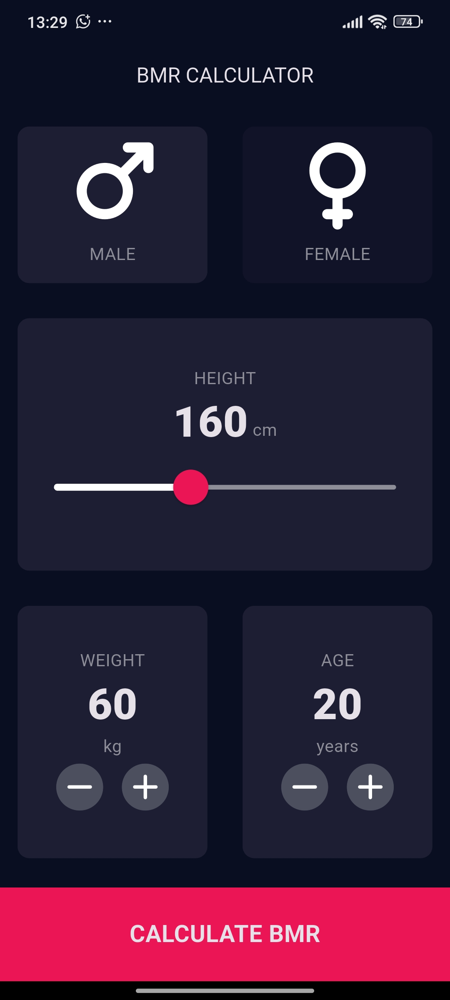
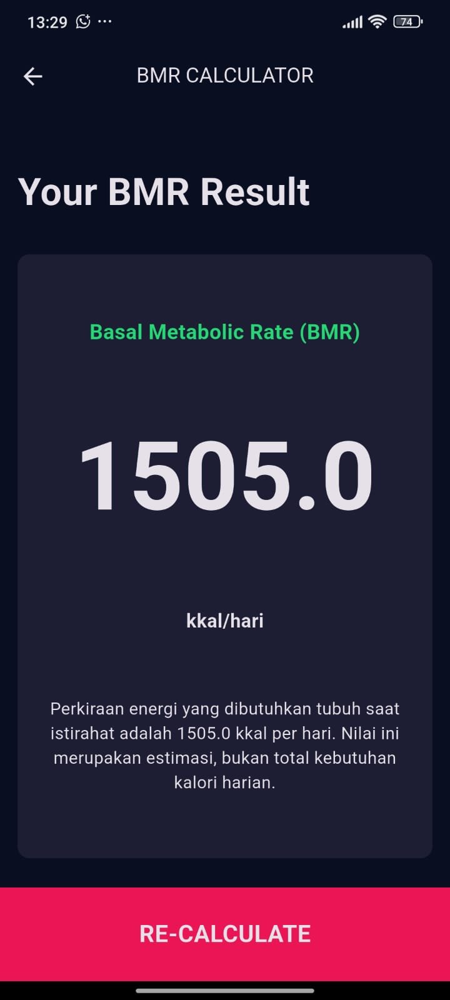

# Kalkulator BMR (Basal Metabolic Rate)

Aplikasi BMR adalah perangkat lunak menggunakan flutter yang digunakan untuk menghitung Basal Metabolic Rate(Laju Metabolisme Basal)—yaitu jumlah kalori minimum yang dibutuhkan tubuh untuk menjalankan fungsi dasar saat beristirahat total, seperti bernapas, memanaskan darah, dan mengatur suhu tubuh. 

Proyek ini merupakan tugas mata kuliah **Pemrograman Perangkat Bergerak**, yaitu mengubah aplikasi Kalkulator BMI menjadi Kalkulator BMR.

## Anggota Kelompok

| 1. Ahmad Fathoni Nur M | [K3524040] |
| 2. Ghali Shiddiq | [K3524054] |
| 3. hafiz irsyad Al Thof | [K3524076] |

## Deskripsi

Pengguna memasukkan **jenis kelamin, usia, berat badan, dan tinggi badan**. Aplikasi kemudian menghitung BMR menggunakan rumus **Mifflin-St Jeor**:

- **Pria:** BMR = (10 × berat kg) + (6,25 × tinggi cm) − (5 × usia) + 5
- **Wanita:** BMR = (10 × berat kg) + (6,25 × tinggi cm) − (5 × usia) − 161

Hasil ditampilkan dalam satuan **kkal/hari**.

### Fitur
- Input jenis kelamin, usia, berat badan, dan tinggi badan
- Validasi input (menampilkan pesan jika data kosong atau tidak valid)
- Perhitungan BMR dengan rumus Mifflin-St Jeor
- Tampilan hasil yang jelas dalam kkal/hari

### Perubahan dari Kalkulator BMI
| Kalkulator BMI | Kalkulator BMR |
|----------------|----------------|
| Input: berat dan tinggi | Input: jenis kelamin, usia, berat, dan tinggi |
| Rumus: berat / (tinggi m)² | Rumus: Mifflin-St Jeor |
| Hasil: angka indeks + kategori | Hasil: kebutuhan kalori (kkal/hari) |

Referensi: https://www.calculator.net/bmr-calculator.html

## Tangkapan Layar

| Tampilan Awal | Hasil Perhitungan |
|---------------|-------------------|
|  |  |

## Cara Menjalankan
